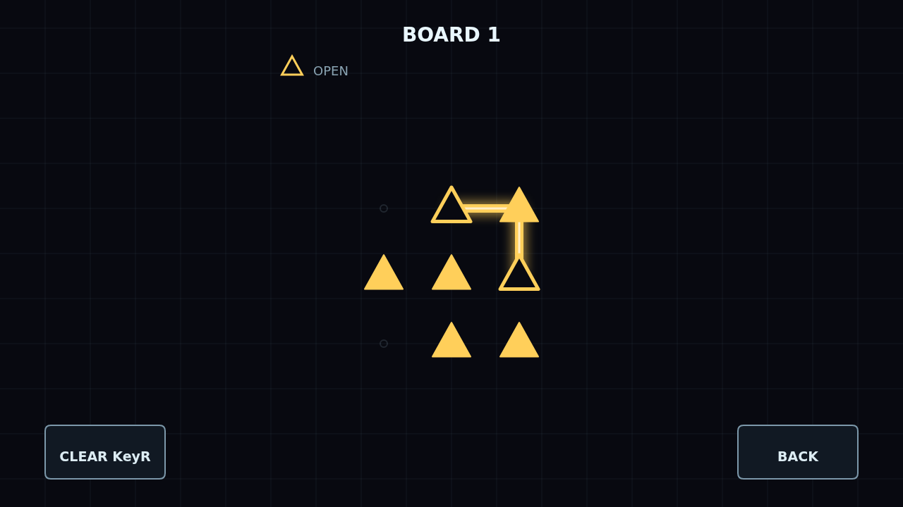

# Refract

Refract is a light-tracing puzzle played on a dark optical bench. Each board is
made of optical nodes: emitters start and end a color channel, lenses must be
threaded by that same channel, and crystals can be crossed by any beam until
their charges are spent.

You draw the light directly. Press an emitter or the end of an existing beam,
then drag from node to neighboring node. Legal moves connect instantly, while
moves that would cross, reuse a segment, touch the wrong channel, or overfill a
crystal simply refuse to take.

Campaign offers 24 handcrafted boards that introduce the rules, then combine
channels and shared crystals in tighter arrangements. Cascade keeps generating
new boards as you solve, climbing through tiers with larger layouts and denser
constraints.

The puzzle is solved when every channel runs between its emitters, every lens is
threaded, and every crystal charge has been spent exactly.
